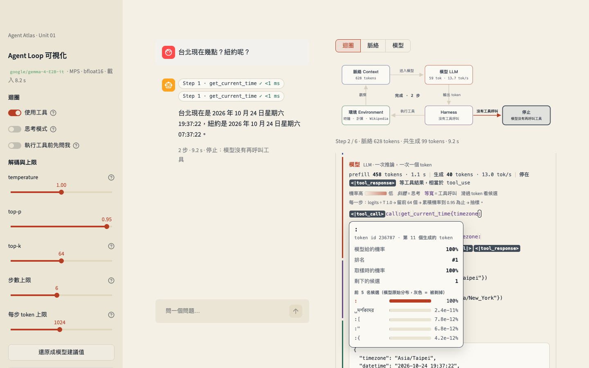

# Agent Loop 可視化

- 模型：[google/gemma-4-E2B-it](https://huggingface.co/google/gemma-4-E2B-it)，在本機用 Hugging Face `transformers` 推論
- 授權：[Apache License 2.0](LICENSE)

左邊是像 ChatGPT 的聊天介面，右邊一步一步畫出 agent 迴圈：模型讀進脈絡、提出動作、harness 去執行、結果接回脈絡，直到停止。模型跑在你自己的電腦上，所以每個 token 的機率、候選 token、特殊 token、prefill 和生成速度都看得到。



## 畫面上看得到什麼

| 畫面 | 看得到的東西 | 對應 unit 01 導讀 |
|---|---|---|
| 迴圈圖 | 目前在脈絡、模型、harness、環境、停止哪一格，正在流動的箭頭 | §4 Agent 就是放在迴圈裡的模型 |
| 脈絡 | 每一步模型讀到的完整字串：system prompt、`<\|tool>` 工具 schema、對話，以及上一步接回來的 `<\|tool_response>` | §1 脈絡有上限、§3 工具定義也是 token |
| 模型 | 每個生成的 token，顏色越深代表被選中的 token 機率越低。滑過 token 看機率、排名、前 5 名候選，以及 top-k / top-p 剃掉了哪些 | §1 LLM 是會抽樣的條件機率分布、解碼設定 |
| Harness | 從 Gemma 格式解析出的工具呼叫、schema 驗證結果、重複呼叫警告、你的允許或拒絕 | §3 模型從不直接碰環境 |
| 環境 | 工具實際回傳的結果與耗時 | §2 環境與可觀察的狀態 |
| 停止 | 停止原因和停止 token：`<turn\|>`（相當於 end_turn）、`<\|tool_response>`（相當於 tool_use）、步數上限、token 上限、使用者中斷 | §5 什麼時候停 |
| 模型分頁 | 參數量拆解、層數、attention heads、sliding window、脈絡上限、解碼設定的說明、每一步的 prefill 時間與 tok/s | §1、§7 Agent 是系統 |

## 快速開始

需求：

- macOS（Apple Silicon，用 MPS）、有 CUDA 的 Linux，或只用 CPU（很慢）
- 約 11 GB 磁碟空間放模型權重
- 記憶體：用 MPS 或 CUDA 時建議 16 GB 以上（bfloat16 權重約 10 GB）；只用 CPU 時會以 float32 載入，權重約 20.5 GB，建議 24 GB 以上
- Linux + CUDA：鎖定的 torch 是 CUDA 13 版本，`nvidia-smi` 右上角的 CUDA Version 要 13.0 以上。驅動太舊時 torch 會偵測不到 GPU，改用 CPU 執行；側欄上方會顯示目前用的裝置
- [uv](https://docs.astral.sh/uv/)（會自動裝好 Python 3.12）
- 網路：第一次下載模型，以及 Wikipedia 工具

```bash
uv sync
uv run hf download google/gemma-4-E2B-it   # 先下載權重（約 10 GB）；跳過的話，第一次啟動時會自動下載
uv run streamlit run streamlit_app.py
```

瀏覽器會打開 http://localhost:8501 。第一次載入模型加暖機大約 10–20 秒，之後重新整理頁面不會再載入。

> 下載時出現 401，可是模型明明是公開的？多半是本機存的 Hugging Face token 過期了。重新登入（`uv run hf auth login`），或加上 `HF_HUB_DISABLE_IMPLICIT_TOKEN=1` 不送 token。

## 可以試試看的實驗

1. **只是聊天機器人**：在側欄關掉「使用工具」，問「台北現在幾點？」。模型看不到任何工具，只能猜或承認不知道。打開工具再問一次，比較兩次的脈絡分頁。
2. **抽樣**：同一個問題，temperature 設 0 和 1.5 各跑一次，看 token 的顏色和浮窗裡「剩下的候選」怎麼變。
3. **停止條件**：步數上限設 1，問一個需要工具的問題，停止原因會變成「達到步數上限」。
4. **人的位置**：打開「執行工具前先問我」，然後按「拒絕」。擋下來的是 harness，模型只會在下一步的脈絡裡看到一則錯誤觀察。對照導讀 §5 郵件刪除事件：寫在 prompt 裡的「先確認」會被壓縮掉，寫在 harness 裡的不會。
5. **推理也是 token**：打開「思考模式」，斜體的思考 token 會出現在工具呼叫之前；脈絡分頁裡 system turn 的開頭會多一個 `<|think|>`。
6. **迴圈會打轉**：問「ReAct 這篇論文是誰提出的？用 Wikipedia 查。」。E2B 常常重複同一個搜尋，harness 會標出「跟之前一模一樣的呼叫」，對照導讀 §4 ReAct 的錯誤分析。

## 架構

```
streamlit_app.py   版面、session state、背景 thread；執行中每 0.5 秒重畫一次
render.py          把事件列表轉成 HTML：迴圈圖、step 卡片、token 熱度與浮窗、脈絡檢視
agent.py           harness：組 prompt → 生成 → 解析 → 驗證 →（先問你）→ 執行工具 → 接回脈絡 → 判斷要不要停
llm.py             本機 Gemma 推論，自己寫的解碼迴圈
gemma_format.py    解析 Gemma 4 的輸出格式
tools.py           工具：schema（給模型看）加上 Python 函式（給 harness 執行）
tests/             pytest 測試，見下面「測試」
```

agent 在背景 thread 執行，每走到一個階段就 append 一個事件；UI 只負責把事件列表畫出來。所以按「停止」或「允許」時 Streamlit 重跑 script，背景的迴圈不會被打斷。

一次執行的事件依序是：`run_start`，然後每一步 `step_start` → `context` → `prefill` → `token` ×N → `model_end` → `parsed`，有工具呼叫時再加上 `tool_call` →（`approval_request` → `approval`）→ `tool_start` → `tool_result`，最後是 `run_end`。

### 為什麼自己寫解碼迴圈

`model.generate()` 不會在每一步把機率分布交出來，所以 `llm.py` 自己跑迴圈：每個 token 做一次 forward pass（帶 KV cache），依序套用 temperature、top-k、top-p，再抽樣。每個 token 因此都能回報：在模型原始分布裡的機率和排名、取樣時的機率、top-k / top-p 之後剩幾個候選，以及前 5 名候選。Greedy 模式下的輸出和 `generate()` 實測一致。

### Gemma 4 的格式

工具呼叫長這樣。字串用 `<|"|>` 這個特殊 token 包起來，key 也不加引號，所以不是 JSON，`gemma_format.py` 有自己的小 parser：

```
<|tool_call>call:get_current_time{timezone:<|"|>Asia/Taipei<|"|>}<tool_call|><|tool_response>
```

模型寫完工具呼叫會停在 `<|tool_response>`，等 harness 接上結果；回答完則停在 `<turn|>`。這兩個停止 token 正好對應到 Anthropic Messages API 的 `stop_reason: tool_use` 和 `end_turn`。

## 測試

```bash
uv run pytest                                          # 約 10 秒，不載入模型權重、不連網路
RUN_MODEL_TESTS=1 uv run pytest tests/test_real_model.py   # 載入真的 Gemma，約 30 秒
```

大部分測試用 `tests/fakes.py` 的假模型：它照劇本一個 token 一個 token 吐出預先寫好的輸出，介面和 `LocalLLM` 一樣，所以 harness 和網頁可以從頭跑到尾。

| 檔案 | 測什麼 |
|---|---|
| `test_gemma_format.py` | 思考、工具呼叫、回覆的切分；`<\|"\|>` 字串、巢狀參數、各種格式錯誤 |
| `test_tools.py` | schema 驗證與預設值、計算機的 AST 白名單（拒絕 `__import__` 之類）、時區、Wikipedia（HTTP 用假的） |
| `test_llm.py` | 自己寫的解碼迴圈：KV cache、停止 token、token 上限、中斷、channel 切換、被拆開的中文字元；temperature / top-k / top-p 的候選與機率 |
| `test_agent.py` | harness：事件順序、工具結果接回脈絡、驗證錯誤、重複呼叫、結果截斷、每一種停止原因、允許 / 拒絕 / 等待時按停止 |
| `test_render.py` | 一次執行的每一個事件前綴都能畫出來（執行中每 0.5 秒重畫）、HTML 標籤成對、迴圈圖是合法 SVG、模型輸出一律跳脫 |
| `test_app.py` | 用 Streamlit `AppTest` 操作整個網頁：送出問題、範例按鈕、側欄設定傳到模型、多輪對話、脈絡與模型分頁、允許 / 拒絕 / 停止、新對話、還原設定、兩個分頁不能同時跑 |
| `test_chat_template.py` | 用真的 Gemma tokenizer（本機有快取才跑）：控制 token 都是單一 token、模板寫進歷史的工具呼叫能被 parser 讀回；用真的模板跑 harness，確認 step 卡片標成「新加入」的剛好是工具結果（兩個參數、思考模式、工具呼叫前有文字） |
| `test_real_model.py` | 預設跳過。greedy 解碼和 `model.generate()` 一致，真的模型能呼叫計算機並回答 |

## 已知限制

- 速度：Apple M5（32 GB）上大約 7–13 tok/s。思考模式一步常有兩、三百個思考 token，要等 30 秒左右。
- 只有一份模型，一次只能跑一個 agent，其他分頁要等。執行中重新整理或關掉分頁，agent 不會跟著停；其他分頁（包括重新整理後的同一頁）會顯示它還在跑，並提供「停止那個 agent」按鈕。
- 開著「執行工具前先問我」時，等確認超過 5 分鐘沒有回應，harness 會當作拒絕並停止迴圈，停止原因顯示「等待確認逾時」。
- token 浮窗要等那一步生成完才會出現，生成中只有熱度顏色，避免每次重畫都送出大量 HTML。浮窗是純 CSS，太靠近時間軸底部的 token，浮窗可能被切到。
- E2B 很小：可能用簡體中文回答、重複同一個搜尋，或在思考裡算錯。這些剛好是可以觀察的材料。
- Wikipedia 工具需要網路。
- `MODEL_ID` 環境變數可以換成其他 Gemma 4 模型。其他模型家族的工具呼叫格式不同，`gemma_format.py` 解析不了。

## 授權

本專案的程式碼以 [Apache License 2.0](LICENSE) 授權。Gemma 4 模型權重由 Google 以 Apache 2.0 釋出（見[模型卡](https://huggingface.co/google/gemma-4-E2B-it)），不包含在本專案裡。

AI 使用說明：程式碼由 Claude Code 協助撰寫，並在本機用 gemma-4-E2B-it 實際執行、用瀏覽器檢查過畫面。
