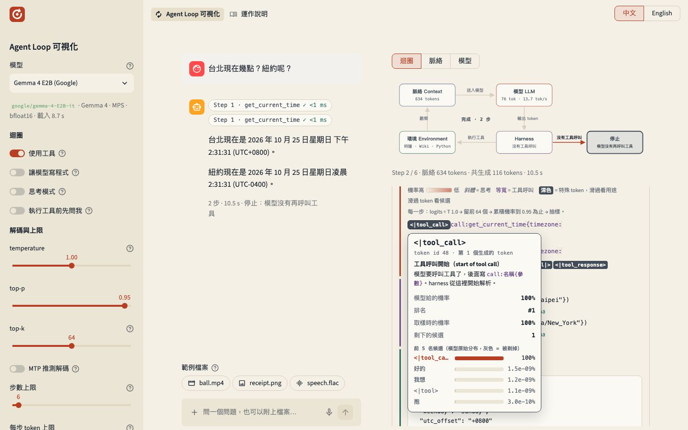

# Agent Loop 可視化

[English](README.md) | 繁體中文



這個專案是學習用的：用更直覺、更視覺化的方式，讓你看懂 agent 迴圈在底層怎麼運作。Agent 的聊天框背後跑著一個迴圈：一步接著一步，模型提出動作、harness 去執行，直到停止。一般的聊天 app 只讓你看到問題和答案；這個網頁在每一步發生的當下把它畫出來，細到模型寫下的每一個 token，整個機制攤開在你眼前。畫面上的每個部分都對應 [Agent Atlas 技術與實戰交流](https://cyyeh.github.io/agent-atlas-learning/) unit 01 導讀的一節，本專案就是它的專案之一；[可以試試看的實驗](#可以試試看的實驗)則把這些概念變成可以自己動手試的實驗。

- 模型：側欄可以選 [google/gemma-4-E2B-it](https://huggingface.co/google/gemma-4-E2B-it) 或 [Qwen/Qwen3.5-0.8B](https://huggingface.co/Qwen/Qwen3.5-0.8B)，在本機用 Hugging Face `transformers` 推論
- MTP 推測解碼：Gemma 4 E2B 可以在側欄打開（預設關閉），用 [google/gemma-4-E2B-it-assistant](https://huggingface.co/google/gemma-4-E2B-it-assistant) 當草稿模型，一次 forward 產生好幾個 token
- 檔案：用輸入框左邊的 ＋ 附上圖片和影片（兩個模型都行）、聲音（Gemma 4 E2B，也可以直接用麥克風錄音），或是在輸入框上方選一個範例檔案（收據、錄音、影片、銷售資料），自己問它問題；每個檔案在脈絡裡變成一串 token，畫面上看得到
- 寫程式（選用）：在側欄打開「讓模型寫程式」，模型多一個 `run_python` 工具，它寫的 Python 在 Docker 沙箱裡執行，讀得到你附上的資料檔（CSV、TSV、JSON、純文字、Markdown、Excel），也能用 matplotlib 畫圖，圖會出現在聊天區。只有這個功能需要 Docker
- 語言：網頁和運作說明都有繁體中文和英文版，預設跟著瀏覽器的語言，右上角可以切換；選過的語言會記住，下次打開直接用它
- 授權：[Apache License 2.0](LICENSE)

左邊是像 ChatGPT 的聊天介面，右邊一步一步畫出 agent 迴圈：模型讀進脈絡、提出動作、harness 去執行、結果接回脈絡，直到停止。模型跑在你自己的電腦上，所以每個 token 的機率、候選 token、特殊 token、prefill 和生成速度都看得到。不同模型跑的是同一個 harness，換模型時只有它們的文字格式不同，正好可以對照。

[運作說明](https://cyyeh.github.io/agent-loop-visualizer/zh/)把一輪對話從送出到回覆的每一步對應到程式碼，附上檔名、行號和程式片段。它放在 GitHub Pages 上，app 上方的「運作說明」會在新分頁打開它，語言和網頁當下的語言一樣。

## 畫面上看得到什麼

| 畫面 | 看得到的東西 | 對應 unit 01 導讀 |
|---|---|---|
| 迴圈圖 | 目前在脈絡、模型、harness、環境、停止哪一格，正在流動的箭頭 | §4 Agent 就是放在迴圈裡的模型 |
| 脈絡 | 每一步模型讀到的完整字串：system prompt、工具 schema、對話，以及上一步接回來的工具結果。滑過深色的特殊 token 會說明它的用途。附上的圖片、聲音或影片就是它展開成的那一串 token，畫成一個標籤加上個數（`<\|image\|>` ×266），step 卡片也寫出每種媒體佔了幾個 token | §1 脈絡有上限、§3 工具定義也是 token |
| 模型 | 每個生成的 token，顏色越深代表被選中的 token 機率越低。滑過 token 看機率、排名、前 5 名候選，以及 top-k / top-p 剃掉了哪些；特殊 token 另外說明它的用途。打開 MTP 時，草稿模型猜中的 token 有底線，浮窗寫出草稿猜了什麼、有沒有被收下，step 卡片顯示收下幾個、主模型少跑了幾次 forward | §1 LLM 是會抽樣的條件機率分布、解碼設定 |
| Harness | 從模型自己的格式（Gemma 4 或 Qwen3.5）解析出的工具呼叫、schema 驗證結果、重複呼叫警告、你的允許或拒絕 | §3 模型從不直接碰環境 |
| 環境 | 工具實際回傳的結果與耗時；`run_python` 的程式碼寫在上面，印出來的東西或 traceback 寫在下面 | §2 環境與可觀察的狀態 |
| 停止 | 停止原因和停止 token。Gemma 回答完停在 `<turn\|>`（相當於 end_turn）、要工具時停在 `<\|tool_response>`（相當於 tool_use）；Qwen 兩種都停在 `<\|im_end\|>`。另外還有步數上限、token 上限、使用者中斷 | §5 什麼時候停 |
| 模型分頁 | 參數量拆解、層數與層的種類、注意力頭數、脈絡上限、模型讀得懂什麼（文字、圖片、聲音、影片）、MTP 草稿模型、解碼設定的說明、每一步的 prefill 時間與 tok/s（開 MTP 時加上草稿收下幾個、解碼 forward 幾次），tokenizer 全部特殊 token 的 id 與用途（Gemma 24 個、Qwen 33 個），以及 `models/` 裡這個模型資料夾的每個檔案：大小、用途、在這個模型裡裝了什麼、關鍵欄位的值 | §1、§7 Agent 是系統 |
| 運作說明頁 | 一輪對話的 17 個階段（包括圖片怎麼變成 token、MTP 怎麼猜、怎麼驗證），每段附上做這件事的程式碼片段和行號，有中文和英文兩版。放在 GitHub Pages，行號在產生頁面時從原始碼查出來；每次推上 main 都會重新產生，程式改了會跟著更新 | 全部 |

## 快速開始

需求：

- macOS（Apple Silicon，用 MPS）、有 CUDA 的 Linux，或只用 CPU（很慢）
- 磁碟空間放模型權重：Gemma 4 E2B 約 10 GB，Qwen3.5 0.8B 約 1.8 GB；要用 MTP 再加上 Gemma 的草稿模型約 190 MB
- 記憶體：Gemma 用 MPS 或 CUDA 時建議 16 GB 以上（bfloat16 權重約 10 GB），只用 CPU 時會以 float32 載入，約 20.5 GB，建議 24 GB 以上；Qwen3.5 0.8B 小得多，8 GB 的機器也跑得動。同一時間只會載入一個模型，換模型時舊的會被放掉
- Linux + CUDA：鎖定的 torch 是 CUDA 13 版本，`nvidia-smi` 右上角的 CUDA Version 要 13.0 以上。驅動太舊時 torch 會偵測不到 GPU，改用 CPU 執行；側欄上方會顯示目前用的裝置
- [uv](https://docs.astral.sh/uv/) 0.13.4 以上（會自動裝好 Python 3.12）。更舊的版本還信任 eMudhra 那批外洩的 emSign 憑證（[公告](https://discuss.python.org/t/109576)），所以 `uv sync` 會拒絕執行；用 `uv self update`（或 `brew upgrade uv`）更新
- 網路：第一次下載模型，以及 Wikipedia 工具
- 選用：[Docker](https://docs.docker.com/get-started/get-docker/)（Docker Desktop、OrbStack 或 Colima），只有讓模型寫程式時才需要

```bash
uv sync
uv run hf download google/gemma-4-E2B-it --revision 3e22461f65e89153144f8adb70e3b8c2cc9845a7 --cache-dir models   # 先下載權重（約 10 GB）；跳過的話，第一次選到這個模型時會自動下載
uv run hf download Qwen/Qwen3.5-0.8B --revision 2fc06364715b967f1860aea9cf38778875588b17 --cache-dir models       # 約 1.8 GB
uv run hf download google/gemma-4-E2B-it-assistant --revision 2d874ef7d29f9a30599a1e4b3c1cbc9595f005df --cache-dir models   # MTP 草稿模型，約 190 MB；跳過的話，第一次打開 MTP 時會自動下載
uv run streamlit run streamlit_app.py      # 預設先載入 Gemma；MODEL_ID=Qwen/Qwen3.5-0.8B 可以先載入 Qwen
docker build -t agent-loop-sandbox sandbox # 選用：「讓模型寫程式」用的沙箱（約 400 MB）；sandbox/Dockerfile 改了要再建一次
```

瀏覽器會打開 http://localhost:8501 ，語言跟著瀏覽器（中文的瀏覽器看到中文，其他看到英文），右上角的「中文 | English」可以切換，下次打開會用你選過的那個。第一次載入 Gemma 加暖機大約 10–20 秒，Qwen 幾秒；之後重新整理頁面不會再載入。側欄最上面的「模型」選單可以換模型，換了會開新對話，解碼設定也換成新模型的建議值，MTP 回到關閉。側欄的「MTP 推測解碼」第一次打開時才載入草稿模型（不到 1 秒），之後一直留在記憶體裡。

側欄的「讓模型寫程式」預設關閉，關著的時候網頁完全不會去找 Docker。打開之後才檢查 Docker 和 `agent-loop-sandbox` image，缺了哪一個，或 image 是用舊版的 `sandbox/Dockerfile` 建的，就在側欄說明怎麼安裝 Docker 或建 image；兩個都在，模型才拿得到 `run_python`，要寫 Python 的範例也才會出現。你附上的檔案存在 `~/.cache/agent-loop-visualizer/uploads/` 底下，每段對話一個資料夾（按「新對話」就刪掉），沙箱裡看到的是唯讀的 `/data`。

模型下載到專案資料夾裡的 `models/`（git 會忽略它），不是其他專案共用的 `~/.cache/huggingface/hub`；刪掉這個資料夾就能把空間拿回來。每個模型都照固定的 revision 下載，也就是 `families/__init__.py` 裡 `REVISIONS` 的 commit（上面的 `--revision`），所以不管什麼時候下載，拿到的都是這一頁寫作和測試時用的檔案，在每種作業系統上都一樣。想放在別的地方，就把 `AGENT_LOOP_MODELS` 設成那個資料夾（上面的下載指令的 `--cache-dir` 也改成它）；`AGENT_LOOP_MODELS=$HOME/.cache/huggingface/hub` 會用之前已經下載在那裡的模型。`HF_HUB_CACHE` 不會改變位置，因為它常是整台電腦所有專案共用的設定。

想改在 vLLM 伺服器上跑模型，見[在 vLLM 伺服器上跑模型](#在-vllm-伺服器上跑模型)。

> 下載時出現 401，可是模型明明是公開的？多半是本機存的 Hugging Face token 過期了。重新登入（`uv run hf auth login`），或加上 `HF_HUB_DISABLE_IMPLICIT_TOKEN=1` 不送 token。

## 可以試試看的實驗

1. **只是聊天機器人**：在側欄關掉「使用工具」，問「台北現在幾點？」。模型看不到任何工具，只能猜或承認不知道。打開工具再問一次，比較兩次的脈絡分頁。
2. **抽樣**：同一個問題，temperature 設 0 和 1.5 各跑一次，看 token 的顏色和浮窗裡「剩下的候選」怎麼變。
3. **停止條件**：步數上限設 1，問一個需要工具的問題，停止原因會變成「達到步數上限」。
4. **人的位置**：打開「執行工具前先問我」，然後按「拒絕」。擋下來的是 harness，模型只會在下一步的脈絡裡看到一則錯誤觀察。對照導讀 §5 郵件刪除事件：寫在 prompt 裡的「先確認」會被壓縮掉，寫在 harness 裡的不會。
5. **推理也是 token**：打開「思考模式」，斜體的思考 token 會出現在工具呼叫之前；脈絡分頁裡 system turn 的開頭會多一個 `<|think|>`。
6. **迴圈會打轉**：問「ReAct 這篇論文是誰提出的？用 Wikipedia 查。」。E2B 常常重複同一個搜尋，harness 會標出「跟之前一模一樣的呼叫」，對照導讀 §4 ReAct 的錯誤分析。
7. **換模型，harness 不變**：同一個問題分別問 Gemma 和 Qwen，打開脈絡分頁比較：回合標記（`<|turn>` 對 `<|im_start|>`）、工具 schema 放的位置、工具呼叫的寫法（`call:名稱{…}` 對 XML）、工具結果接回的位置都不一樣，但 step 卡片裡的 harness、環境、停止判斷完全相同。
8. **MTP：猜得中才會快**：在 Gemma 打開「MTP 推測解碼」，按「台北現在幾點？紐約呢？」，在關著「讓模型寫程式」時輸入「Write a Python function to test for primes.」，再問「用三段話介紹台北。」。比較每一步的 tok/s 和底線：工具呼叫幾乎每個 token 都被草稿猜中，英文程式碼約一半，中文長文只有一成左右。把 temperature 設成 0 再開關 MTP 各跑一次，輸出會一模一樣：草稿模型只決定要跑幾次 forward，不決定寫出什麼。

9. **圖片也是 token**：按收據的範例。在 step 卡片的脈絡段和脈絡分頁裡，這張圖是幾百個 `<|image|>`（Gemma）或 `<|image_pad|>`（Qwen），這就是它在脈絡裡的成本。品項加起來是 360，收據上卻寫 370；看看模型是自己加，還是呼叫工具。
10. **脈絡決定模型聽不聽**：用 Gemma 在中文頁按錄音的範例，它會把那句英文寫下來再翻譯。換到英文頁、開著「使用工具」問「Transcribe this recording.」，它常說自己聽不到聲音，有時還已經把那句話寫進了工具呼叫的參數；關掉「使用工具」再問一次，它就寫出來了。模型和聲音的 token 都一樣，只有脈絡不同。
11. **在沙箱裡寫程式**：打開「讓模型寫程式」（需要 Docker），按銷售資料的範例。你的訊息最後多了一段說明，寫著檔案的路徑和第一行；step 卡片寫出模型的程式碼，沙箱印出來的東西或 traceback 當作觀察接回去，程式出錯的話模型下一步可以改。也換 Qwen 試試：它通常算得出每個月的合計，接著卻把自己的程式寫壞。
12. **圖是給你看的，不是給模型**：打開「讓模型寫程式」，在輸入框上方的範例檔案選 sales.csv，請它畫出每個月的營收。圖出現在聊天區和畫它的那一步底下，模型讀到的觀察卻只有 `{"figures": ["/data/figure-1.png"]}`：它在描述一張自己沒看過的圖。

## 架構

```
streamlit_app.py   版面、session state、模型選單、語言切換、背景 thread；執行中每 0.5 秒重畫一次
guide.py           「運作說明」頁：中英文內容、行號查詢，以及產生放上 GitHub Pages 的靜態 HTML
i18n.py            兩種語言：pick() 依語言挑文字，from_locale() 從瀏覽器語言決定預設
render.py          把事件列表轉成 HTML：迴圈圖、step 卡片、token 熱度與浮窗、脈絡檢視
agent.py           harness：組 prompt → 生成 → 解析 → 驗證 →（先問你）→ 執行工具 → 接回脈絡 → 判斷要不要停
simple_backend.py  本機推論，自己寫的解碼迴圈；MTP 的草稿與驗證也在這裡
vllm_backend.py    在 vLLM 伺服器上跑模型（VLLM_URL）：prompt 在這裡 render、切 token，token id 送給伺服器，它對每個 token 說得出的都傳回來；伺服器加了對應的參數時，還有媒體、sampling mask 和 MTP 的猜測
backend.py         harness 和畫面透過它使用模型的 Backend：render、encode、generate，以及 token 事件的欄位；app 跑的是 simple_backend.py 這一個
families/          跟著模型走的東西：每個模型家族怎麼寫回合、思考、工具呼叫，哪些 token 會停、各是什麼意思
  __init__.py      Family 的定義、模型選單 MODELS、MTP 草稿模型 DRAFTERS、依 config.json 的 model_type 找家族
  gemma4.py        Gemma 4：輸出的 parser 與 24 個特殊 token 的說明
  qwen3_5.py       Qwen3.5：輸出的 parser 與 33 個特殊 token 的說明
tools.py           工具：schema（給模型看）加上 Python 函式（給 harness 執行）；run_python 的 Docker 沙箱
media.py           附件：存檔、寫進使用者訊息，把圖片、聲音、影片解碼給 processor
sandbox/           run_python 的沙箱：Dockerfile（Python 3.12 加上 numpy、pandas、openpyxl、tabulate、matplotlib），以及把圖送回來的 matplotlib backend 和設定
assets/            網頁的樣式和運作說明的 script；logo.svg；examples/ 是範例附上的檔案，也是輸入框上方的範例檔案
tests/             pytest 測試，見下面「測試」
models/            下載的模型（git 會忽略它；AGENT_LOOP_MODELS 可以換位置）
```

agent 在背景 thread 執行，每走到一個階段就 append 一個事件；UI 只負責把事件列表畫出來。所以按「停止」或「允許」時 Streamlit 重跑 script，背景的迴圈不會被打斷。

「運作說明」是一個靜態頁：`uv run python guide.py _site` 會寫出 `_site/zh/index.html` 和 `_site/en/index.html`（樣式和一小段 script 都內嵌在裡面，可以直接用瀏覽器打開），以及 `_site/index.html`：它把讀者送到上次在頁面右上角選過的語言，沒選過就照瀏覽器的語言。推上 main 時，`.github/workflows/pages.yml` 先跑 `tests/test_guide.py`，再做同一件事並發佈到 GitHub Pages；測試沒過的話，網站上維持原來那一版。

### 兩種語言

畫面上的每一段文字都中英文並排寫在程式裡：程式碼裡是 `pick(lang, "中文", "English")`，資料（特殊 token 的說明、停止原因、運作說明的段落）是 `{"zh": …, "en": …}`。`render.py` 的每個函式都多一個 `lang` 參數，事件本身不分語言，所以切換語言就是用另一種語言重畫同一份事件，跑完的對話也會跟著換。網頁先看 cookie 裡上次選的語言，沒有就看瀏覽器的 `navigator.language`（`zh` 開頭是中文，其他是英文）；切換時頁面用一小段 script 寫入 cookie，因為 Streamlit 只讀得到 cookie、寫不了。

模型讀到的錯誤（參數不對、工具失敗、你拒絕了）也用這一輪開始時網頁的語言寫，因為它們會原封不動變成觀察；system prompt 兩種語言都一樣，所以模型的行為不跟著網頁語言變。

一次執行的事件依序是：`run_start`，然後每一步 `step_start` → `context` → `prefill` → `token` ×N → `model_end` → `parsed`，有工具呼叫時再加上 `tool_call` →（`approval_request` → `approval`）→ `tool_start` → `tool_result`，最後是 `run_end`；出錯時它前面還有一個 `error`：`message` 是例外的訊息，backend 的錯誤（例如 vLLM 伺服器的）另外帶著兩種語言的版本（`text`），畫面顯示目前語言的那一個。`context` 帶的是模型實際讀到的 prompt（每個附件都展開成它的 token），以及每種媒體佔了幾個 token（`media_tokens`）。`token` 帶著這個 token，以及 backend 知道的話，它的機率、排名、前 5 名候選和 MTP 草稿模型猜了什麼（`backend.TOKEN_DETAILS`）：`simple_backend.py` 全都知道；backend 沒有回報的，畫面就不畫，不會拿沒量過的數字來填。等這一步結束才知道哪些 token 是 MTP 猜中的 backend（vLLM 伺服器），把它們放在 `model_end` 的 MTP 統計裡（`kept_at`、`turned_down_at`），畫面到那時才標出來。`tool_result` 帶著模型讀的觀察，另外還有工具做給你看的圖（`images`：`run_python` 畫的圖的路徑），模型讀不到。

### 為什麼自己寫解碼迴圈

`model.generate()` 不會在每一步把機率分布交出來，所以 `simple_backend.py` 自己跑迴圈：每個 token 做一次 forward pass（帶 KV cache），依序套用 temperature、top-k、top-p，再抽樣。每個 token 因此都能回報：在模型原始分布裡的機率和排名、取樣時的機率、top-k / top-p 之後剩幾個候選，以及前 5 名候選。Greedy 模式下的輸出和 `generate()` 實測一致；兩個 token 機率一樣時（bfloat16 的 logits 打平比想像中常見）拿 id 小的，和 `generate()` 的 argmax 一樣。

### MTP 推測解碼

解碼時每個 token 都要跑一次完整的 forward，時間主要花在把權重從記憶體讀出來；同一次 forward 多算幾個位置幾乎不會更慢（Gemma 4 E2B 在 Apple M5 上，1 個位置約 56 ms，7 個位置約 70 ms）。所以只要先便宜地猜好接下來幾個 token，主模型就能一次 forward 全部驗證。Google 為 Gemma 4 訓練了這樣的草稿模型（MTP，multi-token prediction），`transformers` 的 `generate(assistant_model=…)` 會用它，但同樣看不到每一步的分布，所以 `simple_backend.py` 把它接進自己的解碼迴圈：

1. **猜**（`_draft`）：草稿模型 `gemma-4-E2B-it-assistant` 約 78M 參數、4 層。它沒有自己的 KV cache，直接讀主模型的 key / value（Gemma 4 E2B 後 20 層本來就共用前面兩層算好的那份），輸入是上一個 token 的 embedding 接上主模型最後一層的 hidden state。一次 greedy 猜 6 個 token（checkpoint 的 `num_assistant_tokens`）。
2. **驗證**（`_drafted`）：主模型對「剛確定的 token + 6 個猜測」做一次 forward，拿回 7 個位置的分布，依序交給 `_sample()` 檢查。收下的猜測不用另外 forward；第一個被退回的猜測，由主模型自己在那個位置選的 token 取代，後面全部作廢，KV cache 用 `crop()` 退回去；6 個都收下時，最後一個位置還能多給一個 token。
3. **輸出不變**：greedy 時，猜測剛好是第 1 名才收下，所以輸出和不開 MTP 一樣（`tests/test_real_model.py` 用真的模型比對）。抽樣時，猜測以「temperature、top-k、top-p 處理後它的機率」被收下，沒收下就從其他候選裡抽，每個 token 最後出現的機率完全不變（speculative sampling，`tests/test_simple_backend.py` 用兩萬次抽樣檢查）。

收下的比例很看內容。在網頁裡用 Gemma 的預設解碼設定實測（Apple M5）：

| 這一步在寫什麼 | 不開 MTP | 開 MTP | 草稿收下 |
|---|---|---|---|
| 工具呼叫（「台北現在幾點？紐約呢？」第 1 步） | 12.6 tok/s | 40.9 tok/s | 34 / 35 |
| 根據工具結果回答（同一題第 2 步） | 13.0 tok/s | 22.6 tok/s | 42 / 106 |
| 英文程式碼，約 750 tokens | 8.8 tok/s | 11.6 tok/s（單獨跑 `simple_backend.py`：8.1 → 29.0） | 51% |
| 中文長文（「用三段話介紹台北。」） | 10.3 tok/s | 10.3 tok/s | 7% |

### 圖片、聲音和影片

模型讀得懂哪些東西，是載入時從 checkpoint 看出來的：config 裡要有那種編碼器，processor 也要有對應的部分。Gemma 4 E2B 讀得懂圖片、聲音和影片；Qwen3.5 0.8B 讀得懂圖片和影片。輸入框只收模型讀得懂的檔案：

| 種類 | 格式 | Gemma 4 E2B | Qwen3.5 0.8B |
|---|---|---|---|
| 圖片 | png、jpg、jpeg、webp、gif、bmp | 最多 280 個 token | 看圖片大小（640×480 約 300 個） |
| 聲音 | wav、mp3、m4a、flac、ogg | 每 40 ms 一個 token，只聽前 30 秒 | —（打開「讓模型寫程式」時當成給 `run_python` 的檔案） |
| 影片 | mp4、mov、webm、mkv | 32 張畫格（比這短的影片全部都用），每張前面寫上時間 `mm:ss`，每張最多 70 個 token | 每秒 2 張畫格，每 2 張一組，前面寫上時間 |
| 資料 | csv、tsv、json、txt、md、xlsx | 打開「讓模型寫程式」時給 `run_python` 讀 | 同左 |

chat template 在每個檔案的位置寫一個佔位 token（Gemma 是 `<|image|>`，Qwen 是 `<|vision_start|><|image_pad|><|vision_end|>`），`LocalLLM.encode()` 把對話裡所有檔案交給 processor，processor 把每個佔位 token 展開成那個檔案的 token；脈絡分頁顯示的就是展開後的字串，因為那才是模型讀到的。檔案先由 `media.py` 解碼：圖片轉成 RGB、照 EXIF 轉正；聲音用 PyAV 解碼成單聲道、改成 feature extractor 要的 16 kHz；影片平均取最多 64 張畫格、縮到長邊 768 像素（transformers 自己讀影片要裝 torchcodec）。每個檔案只解碼一次。prefill 時，圖片和影片先跑一次視覺編碼器再交給 prefill，和 `generate()` 的做法一樣（直接交給 forward 的話，transformers 5.20 的 Gemma 4 會漏掉影片的畫格數）；Qwen3.5 記在模型上的圖片位置偏移，每次 prefill 前清掉。prefill 之後的解碼和純文字一樣；`tests/test_real_model.py` 確認附上圖片、影片和錄音時，greedy 的輸出也和 `generate()` 一致。

### 在 Docker 沙箱裡寫程式

打開「讓模型寫程式」而且 Docker 準備好時，模型多一個工具 `run_python`。每次呼叫都從 `sandbox/Dockerfile` 建的 image 開一個新容器：沒有網路，檔案系統唯讀、只有一小塊 `/tmp` 能寫，記憶體 512 MB、一顆 CPU、最多 64 個 process，拿掉所有 Linux capability，用你自己的使用者執行、絕不用 root（在 Linux 上，掛進去的資料夾保留原本的權限，換成別的使用者可能進不去），這段對話的資料夾唯讀掛在 `/data`；程式從 stdin 送進去，跑完容器就刪掉。超過 30 秒就停掉；結束代碼不是 0、記憶體用太多或什麼都沒印（也沒畫圖），都用這一輪的語言當成錯誤回給模型，附上 traceback，模型下一步可以改。

容器寫不進任何頁面讀得到的地方，matplotlib 畫的圖還是回得來：image 把 matplotlib 的 backend 設成 `sandbox/agent_loop_figures.py`，它在 `plt.show()` 或程式結束時把每張圖轉成 PNG，程式結束前接在印出來的東西後面，前面加一行 `run_python` 傳進去的記號。`run_python` 把它們從模型要讀的輸出切掉（最多四張），存進這段對話的資料夾，叫 `figure-1.png`、`figure-2.png`…，和觀察分開回傳：模型只讀到 `{"stdout": …, "figures": ["/data/figure-1.png"]}`，頁面把圖畫在聊天區和那一步底下。中文的標籤用 image 為此裝的文泉驛微米黑畫。載入 matplotlib 讓一次呼叫慢了約半秒（0.8 秒，純 Python 是 0.2 秒）。

image 先用 wheel 加 hash 裝好 pip 26.2.2，再用它裝其他套件：更舊的 pip 也信任它自己帶的那份 certifi，裡面還有外洩的 emSign 憑證。頁面會讀 image 的 `agent-loop-sandbox.version` label，比 `sandbox/Dockerfile` 舊就在側欄請你重建，不提供 `run_python`。

模型看不到資料檔的內容，所以 harness 在使用者訊息後面加一段說明：`run_python` 在哪裡找得到每個檔案，以及文字檔的第一行（CSV 就是欄位名稱）。少了這一行，小模型寫程式時會亂猜欄位，例如不存在的 `Date`，然後出錯；多給幾列資料也不行，Gemma 會把那幾列抄進程式，只用它們算答案。image 裡有 `tabulate`，因為小模型很愛用的 `DataFrame.to_markdown()` 需要它。

### 在 vLLM 伺服器上跑模型

模型也可以放在 [vLLM](https://docs.vllm.ai/) 伺服器上跑，伺服器在這台電腦或一台有 GPU 的 Linux 機器都可以，網頁還是在你的電腦上。把 `VLLM_URL` 設成伺服器的位址：

```bash
# 跑 vLLM 的地方（vLLM 0.32 以上，Linux 加 GPU）。--revision 是 REVISIONS 裡的 commit，伺服器和網頁讀的就是同一份
# tokenizer 和 chat template。其他參數讓網頁看得到更多（見下面）。
vllm serve Qwen/Qwen3.5-0.8B --revision 2fc06364715b967f1860aea9cf38778875588b17 --enable-scale-out
# 或是 Gemma 4 E2B 加上它的 MTP 草稿模型，回報哪些 token 是猜中的：
vllm serve google/gemma-4-E2B-it --revision 3e22461f65e89153144f8adb70e3b8c2cc9845a7 --enable-scale-out \
  --speculative-config '{"method": "mtp", "model": "google/gemma-4-E2B-it-assistant", "revision": "2d874ef7d29f9a30599a1e4b3c1cbc9595f005df", "num_speculative_tokens": 6}' \
  --per-request-spec-decode-metrics detailed
# 或是開 sampling mask：看得到剩下幾個候選，但換掉模型自己的機率（見下面）：
vllm serve Qwen/Qwen3.5-0.8B --revision 2fc06364715b967f1860aea9cf38778875588b17 --enable-scale-out \
  --return-sampling-mask --logprobs-mode processed_logprobs

# 跑網頁的地方：
VLLM_URL=http://localhost:8000 uv run streamlit run streamlit_app.py
```

側欄的模型選單會列出伺服器提供的模型。伺服器用了 `--api-key` 的話，把同一把 key 放在 `VLLM_API_KEY` 給網頁（`vllm serve` 也是從這個變數讀）。伺服器的 KV cache 放不下模型完整的脈絡長度時，用 `--max-model-len` 調低；網頁的脈絡上限會跟著伺服器。

`vllm_backend.py` 是 `simple_backend.py` 之外的第二個 `Backend`（`backend.py`）；harness、工具和網頁都不用改。prompt 一樣精確：網頁把模型的設定檔、tokenizer 和 chat template 下載到 `models/`（不下載權重），自己 render、自己切 token，再把 token id 送給伺服器，所以伺服器讀到的就是脈絡分頁上的那一串。每個 token 回來時帶著它的 id、log 機率，以及那個位置最可能的幾個 token 的 log 機率。vLLM 預設的 `--logprobs-mode raw_logprobs` 下，這些就是模型自己的分布，和 `simple_backend.py` 一樣，由此得到浮窗裡「模型給的機率」和前 5 名候選。網頁還能看到多少，看伺服器加了哪些參數；載入時，網頁用只生成一個 token 的請求問伺服器加了哪些：

| 伺服器參數 | 每一步送到哪裡 | 畫面多了什麼 |
|---|---|---|
| 都沒有 | `/v1/completions` | 機率、前 5 名，token 在前 5 名裡時才有排名；只讀文字 |
| `--enable-scale-out` | `/inference/v1/generate` | 每個 token 的排名，以及伺服器收的圖片、聲音和影片 |
| 再加 `--return-sampling-mask --logprobs-mode processed_logprobs` | 同上 | 剩下的候選和取樣時的機率，但換掉模型給的機率、熱度和前 5 名：vLLM 只在 processed log 機率下送 sampling mask，這時也不接受 temperature 0 和 top-k 0，所以側欄從 0.05 和 1 開始 |
| `--per-request-spec-decode-metrics summary` / `detailed` | 兩條都行 | 每一步 MTP 的統計；`detailed` 的話，step 結束時猜中的 token 也有底線 |

畫面不畫的，就不會自己編（`backend.TOKEN_DETAILS`）。細節：

- **`--logprobs-mode`** 決定這些數字是什麼，但沒有哪條路會說伺服器用的是哪一種，所以載入時網頁要一個 token，temperature 1、top-k 2、要最可能的 5 個：processed 模式下，被 top-k 剃掉的 3 個會回 -9999；log 機率加起來最多是 1，logits 不會。用 `processed_logprobs` 時（`--return-sampling-mask` 一定要它；沒有它，或沒有 vLLM 的 Model Runner V2，伺服器就不啟動，而 V2 在能用的情況下是預設），token 的 log 機率是它在抽樣分布裡的機率，已經套過 temperature、top-k、top-p，所以浮窗把它當成取樣時的機率，加上排名，不顯示模型給的機率、熱度和前 5 名。剩下幾個候選來自 sampling mask；沒有 mask 時，只有在 top-k / top-p 剃掉了列出來的幾個最可能的 token 時才看得到。用 `raw_logits` 或 `processed_logits` 時，這些數字不是機率，畫面不會把它們當成機率顯示。前 5 名裡哪些被 top-k / top-p 剃掉（`simple_backend.py` 的浮窗裡的灰色），哪一種模式都看不到：模型自己的機率和取樣器做了什麼，不會一起回來。模型分頁會寫伺服器用的是哪一種。
- **greedy 解碼**（temperature 0）不用伺服器說也知道只剩一個候選、抽中的機率是 1，所以只要伺服器接受 greedy，浮窗都會顯示。啟動時加了 `--return-sampling-mask` 的伺服器不接受：vLLM 在每條路上都拒絕 temperature 0 和 top-k 0，所以側欄的滑桿最低到 0.05 和 1，模型建議值比這還低時就調到這裡。沒加 `--enable-scale-out` 時，沒有哪個回應看得到 mask，所以載入時網頁也會向這種伺服器（processed log 機率的）要一個 greedy 的 token，被拒絕就知道了。
- **圖片、聲音和影片**跟著 chat template 寫的佔位 token 一起送過去，放在伺服器的 `content_parts`：圖片照 EXIF 轉正存成 PNG；聲音在這裡解碼成 WAV；影片送原檔，由伺服器挑畫格。伺服器把每個佔位 token 展開成那個檔案的 token。為了讓脈絡分頁顯示伺服器讀到的 prompt，網頁先用一個只生成一個 token 的請求問它怎麼展開；生成時伺服器若展開得不一樣，這一步就算錯誤。載入時網頁送一張很小的圖、一段聲音和一段影片給伺服器，看它收哪幾種；它不收的種類（沒加 `--enable-scale-out` 時就是全部）不能附上，輸入框上方會說明，模型分頁列出原因。
- **MTP** 由伺服器決定（`--speculative-config`），所以側欄的開關關著、不能按。伺服器加上 `--per-request-spec-decode-metrics summary` 的話（vLLM 要和 `--speculative-config` 一起才收），每一步會顯示收下幾個猜測、主模型解碼 forward 幾次。vLLM 是在停止 token 截斷那次驗證之前算收下幾個，所以停止 token 是其中一個猜測時，它後面的猜測也算進去。設成 `detailed` 還會說每一次驗證收下幾個猜測，網頁由此標出猜中的 token：第一個 token 來自 prefill，之後每次驗證是收下的猜測，再加一個主模型自己的 token。vLLM 不記沒有猜測的那幾步，所以只有統計剛好對得上每個 token 時才標，而且要等這一步結束，收下的只算到停止 token 為止，和 `simple_backend.py` 一樣；被退回的猜測原本是什麼，伺服器不說。
- **prefill** 是等到第一個 token 的時間，包含網路。vLLM 會留著和上一個 prompt 相同開頭的 KV cache（prefix caching），所以從第 2 步開始只讀新加的部分；`simple_backend.py` 則是每一步都讀完整個 prompt。有媒體時，前面那個問展開方式的請求已經讀過 prompt 的大部分了。
- **模型分頁**寫出伺服器和它的版本；規格來自 `config.json`，脈絡上限來自伺服器。裝置、精度和參數量是伺服器的，這裡不顯示；模型資料夾卡片把權重列成「只在伺服器上」。
- **和 `generate()` 不一定一樣**：vLLM 會把請求合成一批跑，也有自己的 kernel，所以 greedy 的輸出不一定和 `transformers` 逐 token 相同；`simple_backend.py` 的會。

[運作說明](https://cyyeh.github.io/agent-loop-visualizer/zh/)有一段講 `Backend` 介面，把兩個 backend 和它們的程式碼並排說明。

### 支援更多模型

harness（`agent.py`）、解碼迴圈（`simple_backend.py`）和畫面（`render.py`）都只寫一次，裡面沒有任何「如果是 Gemma」的分支。每個模型不一樣的地方集中在 `families/` 的一個 `Family` 物件裡：

- 讀輸出：`parse`（把輸出切成思考、工具呼叫、回覆）、`thought_prefix`、`channel_switch`（哪些 token 切到思考、工具呼叫、回覆）、`stop_tokens`
- 寫回對話：`reasoning_key`（思考存在哪個欄位，chat template 才讀得到）、`text_with_calls`（工具呼叫前的文字留不留）
- 畫面：`user_turn`、`byte_level`（詞表是不是把 byte 寫成字元，Qwen 就是，所以 token 浮窗要顯示「如果」而不是 `å¦Ĥæŀľ`）、每個特殊 token 的說明、`file_notes` 和 `drafter_file_notes`（checkpoint 資料夾裡每個檔案裝了什麼，以及模型分頁要顯示哪些欄位的值）、側欄與模型分頁的說明文字、沒有 generation_config.json 時的建議解碼設定
- 媒體：`processor_kwargs`，給 processor 的設定（Qwen 限制每張影片畫格的像素）；模型讀得懂哪幾種媒體由 checkpoint 決定，不是由家族決定

要加模型：

1. 同一個家族的另一個 checkpoint（例如更大的 Gemma 4 或 Qwen3.5）：在 `families/__init__.py` 的 `MODELS` 加一行，`REVISIONS` 也加一行，寫上要下載的 commit。Gemma 4 的其他 checkpoint 也有對應的 MTP 草稿模型（`google/gemma-4-*-it-assistant`），在 `DRAFTERS` 加一行（草稿模型的 commit 也加進 `REVISIONS`），側欄的 MTP 開關就能用。
2. 新的家族：照 `families/qwen3_5.py` 寫一個模組（輸出的 parser 加上特殊 token 的說明），把它的 `Family` 加進 `FAMILIES`。載入模型時會用 checkpoint `config.json` 裡的 `model_type` 自動找到它。`tests/test_chat_template.py` 會拿真的 tokenizer 和 chat template 檢查新家族：每個特殊 token 都有說明、模板寫進歷史的工具呼叫讀得回來、step 卡片標成「新加入」的剛好是工具結果。

### 兩個模型的格式

Gemma 4 的字串用 `<|"|>` 這個特殊 token 包起來，key 也不加引號，所以不是 JSON，`families/gemma4.py` 有自己的小 parser：

```
<|tool_call>call:get_current_time{timezone:<|"|>Asia/Taipei<|"|>}<tool_call|><|tool_response>
```

Gemma 寫完工具呼叫會停在 `<|tool_response>`，等 harness 接上結果；回答完則停在 `<turn|>`。這兩個停止 token 正好對應到 Anthropic Messages API 的 `stop_reason: tool_use` 和 `end_turn`。

Qwen3.5 用 XML，每個值都是純文字，型別要照工具的 schema 轉（和 vLLM 的 `qwen3_coder` parser 一樣）：

```
<tool_call>
<function=get_current_time>
<parameter=timezone>
Asia/Taipei
</parameter>
</function>
</tool_call><|im_end|>
```

Qwen 不管回答完或要用工具都停在 `<|im_end|>`，所以 harness 是看「解析出來有沒有工具呼叫」決定要不要結束，而不是看停止 token。工具結果會放進一則新的 `user` 訊息（`<tool_response>…</tool_response>`），而不是像 Gemma 接在同一個 model turn 裡。

## 測試

```bash
uv run pytest                                          # 約 40 秒，不載入模型權重、不連網路
RUN_MODEL_TESTS=1 uv run pytest tests/test_real_model.py   # 載入真的 Gemma（含 MTP 草稿模型）和 Qwen，約 4 分鐘；加 -k Qwen 只跑一個
VLLM_TEST_URL=http://localhost:8000 uv run pytest tests/test_vllm_backend.py -k real_server   # 問一台正在跑的 vLLM 伺服器
```

大部分測試用 `tests/fakes.py` 的假模型：它照劇本一個 token 一個 token 吐出預先寫好的輸出，和 `LocalLLM` 一樣是一個 `Backend`（`backend.py`），所以 harness 和網頁可以從頭跑到尾。

網頁收的每一種檔案格式都有測試：`tests/samples.py` 用範例的檔案做出每種格式的小檔案（收據的每種圖片格式、錄音的每種聲音格式、滾動的球的每種影片格式、銷售資料的每種資料格式）。`media.py` 多收了一種格式卻沒有對應的範例檔，`test_media.py` 就會失敗；`test_real_model.py` 拿每一種格式問兩個模型。需要 Docker 的測試只在 Docker 和沙箱 image 都在時才跑。

運作說明會引用程式碼，`tests/guide_excerpts.txt` 存著它引用的每一段程式，不含行號。改到被引用的程式時，`test_guide.py` 會失敗，並列出引用它的段落：重讀那幾段，把不再正確的說明改掉，再用 `UPDATE_GUIDE_SNAPSHOT=1 uv run pytest tests/test_guide.py` 重寫這個檔案。

| 檔案 | 測什麼 |
|---|---|
| `test_gemma4.py` | Gemma 4 的 parser：思考、工具呼叫、回覆的切分；`<\|"\|>` 字串、巢狀參數、各種格式錯誤 |
| `test_qwen3_5.py` | Qwen3.5 的 parser：XML 工具呼叫、照 schema 轉型別、思考、各種格式錯誤；用 Qwen 格式跑完整個 harness |
| `test_families.py` | 每個家族都說明了它用到的 token、中英文說明列出同樣的 token、`model_type` 找得到家族；token 顯示成它代表的文字，只是一個字一部分的 byte 顯示成 `<0xF0>`；每個家族都用中英文說明它 checkpoint 裡的檔案，兩種語言提到同樣的欄位和 token；每個模型和草稿模型都照固定的 commit 下載 |
| `test_tools.py` | schema 驗證與預設值、計算機的 AST 白名單（拒絕 `__import__` 之類）、時區、Wikipedia（HTTP 用假的）；`run_python` 鎖住的 `docker run`、各種錯誤（traceback、沒有輸出、記憶體太多、跑太久、沒有 image）、Docker 沒準備好或 image 過舊時缺什麼，都有中英文兩種；記號後面的圖存檔時不蓋掉現有檔案、只收 PNG、最多四張、程式出錯就不收；image 的版本 label 和用 hash 安裝的 pip；有 Docker 時，真的沙箱讀得到 `/data` 但改不了、連不上網路，讀得了每一種資料格式，送得回中文標籤畫得出來的圖，pip（和它的 certifi）也是修正 emSign 之後的版本 |
| `test_simple_backend.py` | `LocalLLM` 有 `Backend` 的每個方法和屬性，它的 token 帶著每個欄位和細節；自己寫的解碼迴圈：KV cache、停止 token、token 上限、中斷、channel 切換、被拆開的中文字元；`encode()` 照順序把每種媒體和家族的設定交給 processor、短影片給它全部畫格；圖片和影片在 prefill 前先跑視覺編碼器，上一個 prompt 的位置偏移不會留下來；greedy 遇到兩個 token 打平時和 `generate()` 一樣拿 id 小的；temperature / top-k / top-p 的候選與機率；MTP 用照劇本猜的假草稿模型：猜測的收下與退回、全部收下時多一個 token、KV cache 退回多少、草稿模型看不到作廢的猜測，以及抽樣時檢查猜測不改變分布；模型照固定的 revision 下載到 `models/`（`AGENT_LOOP_MODELS` 可以換位置，`HF_HUB_CACHE` 不行），模型資料夾的檔案、大小（經過快取的連結）和說明提到的欄位 |
| `test_agent.py` | 假模型是一個 `Backend`，它的 token 帶的欄位和 `LocalLLM` 的一樣；harness：事件順序、工具結果接回脈絡、驗證錯誤、重複呼叫、結果截斷、每一種停止原因、允許 / 拒絕 / 等待時按停止；附件變成問題裡的 part 和給 `run_python` 的說明、每一輪的媒體都交給 processor、展開後的脈絡仍然只把工具結果標成新加入、`run_python` 拿到這段對話的資料夾、沒有 `run_python` 的一輪；模型讀到圖在哪裡，圖本身只給頁面 |
| `test_render.py` | 一次執行的每一個事件前綴都能用兩種語言畫出來（執行中每 0.5 秒重畫）、HTML 標籤成對、迴圈圖是合法 SVG、模型輸出一律跳脫、特殊 token 的說明浮窗與列表；MTP 的底線、浮窗、統計和草稿模型卡片；一串同樣的特殊 token 畫成一個標籤加個數、截斷的片段不會切開 token、媒體佔了幾個 token、好幾行的程式碼和輸出照行寫出來、這一輪沒提供的工具、一次執行和每一步的圖；模型資料夾卡片：檔案的順序、大小和說明、家族有說明但 checkpoint 沒有的檔案、草稿模型的資料夾、跳脫；backend 沒回報機率、或只回報 log 機率時，token 照它帶的內容畫，不多畫；英文畫面上沒有留下中文 |
| `test_app.py` | 用 Streamlit `AppTest` 操作整個網頁：送出問題、範例按鈕、側欄設定傳到模型、多輪對話、脈絡與模型分頁、允許 / 拒絕 / 停止、新對話、還原設定、兩個分頁不能同時跑、換模型、運作說明連到 GitHub Pages 上同語言的那一版；MTP 開關預設關閉、打開才載入草稿模型、換到沒有草稿模型的 Qwen 會關掉並停用；英文瀏覽器看到英文、上次選的語言優先於瀏覽器、切換語言時對話和設定都留著、模型讀到的錯誤跟著語言；每種語言的頁面只有那種語言的範例、範例會附上它的檔案，模型讀得懂那一種才出現、輸入框上方選的範例檔案會附在接下來打的問題，模型用得上的才列出來、「讓模型寫程式」打開了才去找 Docker 並說明缺什麼、銷售資料的範例用 Python 讀附上的檔案、圖畫在聊天區和畫它的那一步、「新對話」刪掉這段對話的檔案；設了 `VLLM_URL` 時，選單列出伺服器提供的模型、側欄和模型分頁寫出伺服器、MTP 由伺服器決定、開了 sampling mask 的伺服器不會從側欄收到 greedy 或不限的 top-k、模型讀伺服器收的媒體，頁面說明它不收哪些和原因，選單不列伺服器上的 LoRA adapter，伺服器跑到一半送來的錯誤用頁面的語言顯示，載入時或之後連不上伺服器，都用頁面的語言說明 |
| `test_chat_template.py` | 用每個模型真的 tokenizer 和 chat template（已經下載到 `models/` 才跑）：特殊 token 都是單一 token、每個特殊 token 都有說明、token 浮窗顯示的是它代表的文字、模板寫進歷史的工具呼叫能被 parser 讀回；用真的模板跑 harness，確認 step 卡片標成「新加入」的剛好是工具結果（兩個參數、思考模式、工具呼叫前有文字），用真的 processor、問題附上圖片和影片時也一樣；每個模型（和草稿模型）資料夾裡的每個檔案都有說明，說明提到的欄位在檔案裡都找得到 |
| `test_vllm_backend.py` | vLLM backend 對上一個假伺服器，它說的是 vLLM 0.32 的串流格式：`/v1/completions` 收到 render 好的 prompt 的 token id、側欄的每個設定（其他取樣設定都設成不起作用）、停止 token，以及放得進伺服器脈絡的 `max_tokens`；每個 token 的機率和前 5 名，排名只在前 5 名裡才有；加了 `--enable-scale-out` 時走 `/inference/v1/generate`，每個 token 都有排名，雖然選中的 token 排在清單第一個，前 5 名仍照排名；有 sampling mask 時（vLLM 只在 processed log 機率下送），有剩下的候選和取樣時的機率，沒有模型自己的機率，temperature 0 和 top-k 0 在每條路上都照 vLLM 的做法被拒絕，有 mask 但沒加 `--enable-scale-out` 的伺服器，網頁載入時也會發現；載入時用一個 token 判斷伺服器的 `--logprobs-mode`，沒有 mask 的 processed log 機率在前幾名有被剃掉時看得到剩下幾個，logits 只有排名；greedy 是只剩一個、一定抽中的候選；伺服器收哪幾種媒體、每個檔案跟著佔位 token 送過去、脈絡分頁顯示伺服器的展開、生成時展開得不一樣就是錯誤、不收的種類成為一般檔案；兩條路上都有 MTP 的統計，每一步的統計對得上時才標出猜中的 token，收下的只算到停止 token 為止；停止 token、token 上限、按停止就關掉串流；連不上伺服器、它沒有提供的模型、用它自己的資料夾、或用網頁（或它的 transformers）不認得的家族的模型啟動的伺服器、沒有或出錯的 `/inference/v1/generate`、它的拒絕和錯誤，兩種語言都有，跑到一半的錯誤用頁面的語言顯示；暖機，以及第一個 token 之前就結束的一步；模型卡片上的規格、伺服器、每種 logprobs 模式下數字代表什麼、sampling mask 和它不收的媒體；一整輪呼叫工具再回答、一輪附上圖片的問題，每個時刻都畫得出來；用真的 tokenizer 和 chat template（在 `models/` 裡時），伺服器拿到的就是脈絡分頁上的 prompt；設了 `VLLM_TEST_URL` 時問真的伺服器，伺服器加了哪些參數就測哪些 |
| `test_media.py` | 網頁收的每一種格式都有範例檔、被當成正確的種類（聲音對 Qwen 是一般檔案）、解碼得出來；存檔的名字不重複也不含奇怪字元；問題的 part 和寫出文字檔欄位名稱的說明；照片轉正、聲音改成模型的取樣率、影片畫格平均取、畫格率跟著調整；每種聲音和影片播放時的類型，以及 MKV 影片改顯示的畫格 |
| `test_guide.py` | 運作說明頁的每個程式片段和行號都找得到、事件表指向真的送出事件的那一行、HTML 標籤成對；每段引用的程式和 `tests/guide_excerpts.txt` 一致，改到那段程式才會變，只是換了行號不會；中英文每一段指向同樣的程式和段落，英文版沒有留下中文；產生的靜態頁有亮色和暗色兩套配色與迴圈圖、寫出對應的 commit，根目錄的頁面會送到正確的語言 |
| `test_real_model.py` | 預設跳過。每個模型：載入的模型是一個 `Backend`；greedy 解碼和 `model.generate()` 一致，純文字、附上圖片、影片和（Gemma）錄音都一樣，之後再問純文字也一樣；真的模型能呼叫計算機並回答；每一種圖片格式都讀得出收據的總計、每一種聲音格式都寫得出錄音的內容（Gemma；Qwen 收到的是一般檔案）、每一種影片格式都看得出球往哪邊滾、每一種資料格式都能用 `run_python` 打開，也寫得出在沙箱裡跑得動的程式（有 Docker 時）；Gemma 開 MTP 時 greedy 輸出和不開一模一樣（附上圖片也是），而且草稿真的有被收下 |

## 已知限制

- 速度：Apple M5（32 GB）上 Gemma 大約 7–13 tok/s，Qwen3.5 0.8B 大約 20–25 tok/s。思考模式一步常有兩、三百個思考 token，要等 30 秒左右。打開 MTP 後，工具呼叫這類好猜的步驟大約快 3 倍，中文長文幾乎沒有差別（見上面「MTP 推測解碼」的表）。
- MTP 在網頁裡跑長回覆時，加速比單獨跑 `simple_backend.py` 少很多（英文程式碼：單獨跑 8 → 29 tok/s，網頁裡 9 → 12 tok/s），原因還沒查清楚。可能是網頁每 0.5 秒重畫一次、瀏覽器和模型搶同一台機器，而 MTP 每一輪有好幾個很小的草稿 forward，比一般解碼更容易被這些干擾拖慢。
- MTP 只有 Gemma 4 E2B 能開：`transformers` 目前只支援 Gemma 4 的草稿模型讀主模型 KV cache 的這種做法，Qwen3.5 沒有對應的草稿模型。
- 開 MTP 時，主模型一次算 7 個位置，數值和一次算 1 個會有極小的差異；greedy 遇到兩個 token 機率幾乎一樣時，偶爾會選到不同的那個。
- Qwen3.5 的 24 層裡有 18 層是 Gated DeltaNet。transformers 有兩個加速 kernel：`flash-linear-attention`（Triton）和 `causal-conv1d`（CUDA），都要有 CUDA GPU 才能用，所以都不列為依賴：改用 PyTorch 參考實作，結果一樣，只是比較慢；`simple_backend.py` 在所有裝置上都把 transformers 這個「改用參考實作」的提示關掉了。有 GPU 時，對 0.8B 的模型差別不大：在 NVIDIA GB10（DGX Spark）上，裝了 flash-linear-attention 後 prefill 快了約 4 倍（3,571 個 token 從 368 ms 變成 93 ms），decode 幾乎沒變（56 → 60 tok/s），兩種寫法和 float32 的差距也一樣小。causal-conv1d 在那台機器上沒有 wheel，得自己編譯。沒有 GPU 的 Linux 不要裝 flash-linear-attention：transformers 還是會選它，第一次 forward 就會失敗。
- 在 MPS 上，transformers 用多條 thread 載入 Qwen3.5 的權重會卡住，所以 `simple_backend.py` 在 MPS 上改成單一 thread 載入（`HF_DEACTIVATE_ASYNC_LOAD=1`），兩個模型的載入時間都沒有變慢。
- Qwen3.5 0.8B 官方預設不開思考模式；開了容易一直想下去停不下來，可以把「每步 token 上限」調低。它沒附 generation_config.json，建議的解碼設定寫在 `families/qwen3_5.py`（官方建議的 presence penalty 這裡沒有實作）。
- 記憶體裡同時只放一個模型。兩個分頁選了不同的模型時，輪流在兩邊操作會一直重新載入，最好所有分頁用同一個模型。
- 只有一份模型，一次只能跑一個 agent，其他分頁要等。執行中重新整理或關掉分頁，agent 不會跟著停；其他分頁（包括重新整理後的同一頁）會顯示它還在跑，並提供「停止那個 agent」按鈕。
- 開著「執行工具前先問我」時，等確認超過 5 分鐘沒有回應，harness 會當作拒絕並停止迴圈，停止原因顯示「等待確認逾時」。
- token 浮窗要等那一步生成完才會出現，生成中只有熱度顏色（特殊 token 的用途說明除外），避免每次重畫都送出大量 HTML。浮窗是純 CSS，太靠近時間軸底部的 token，浮窗可能被切到。
- 特殊 token 的說明浮窗用 CSS anchor positioning 貼在 token 旁邊，不會被捲動框切到；不支援的瀏覽器會改成直接開在 token 下方，靠近框的底部時可能被切到。
- 兩個模型都很小：可能用簡體中文回答、重複同一個搜尋、只回答一半的問題，或在思考裡算錯。用英文一次問兩個城市的時間時，Gemma 會呼叫兩次工具，然後多半改用中文回答，或在工具結果之後直接停下、沒有回覆；只問一個城市就會用英文回答。這些剛好是可以觀察的材料。
- 只有 Gemma 4 E2B 聽得到聲音，而且只聽前 30 秒。兩個模型都聽不到影片的聲音：影片就是一張張畫格。每張畫格都要 token：Gemma 不管影片多長都取 32 張，約 2,000 個 token 的 prefill；Qwen 每秒取 2 張，token 數跟著影片長度增加（8 秒的範例影片是 640 個）。
- 用英文問、又開著「使用工具」時，Gemma 4 E2B 常說它聽不到附上的錄音，有時還已經把那句話寫進了工具呼叫；用中文問，或關掉「使用工具」，它就寫得出來。所以英文的錄音範例問的是「說了什麼」而不是要它逐字寫下，大約三次成功兩次。
- Qwen3.5 0.8B 用 `run_python` 打得開每一種資料格式，但很少寫對好幾步的 pandas 程式；銷售資料的範例 Gemma 4 E2B 答得出來。
- 沙箱沒有網路，模型沒辦法 `pip install`；裡面有 numpy、pandas、openpyxl、tabulate 和 matplotlib。每次呼叫都是新的容器，變數和 `/tmp` 裡的檔案都不會留到下一次，只有畫的圖存在這段對話的資料夾。
- 模型看不到自己畫的圖：圖送到頁面，不進脈絡，所以它對圖的描述來自自己的程式和數字。用 `plt.savefig()` 存檔後又關掉的圖不會送回來；`plt.show()` 過或留著沒關的才會。
- 對話裡的聲音和影片用瀏覽器自己的播放器播放；Safari 播不了 MKV 影片，所以 MKV 改成顯示模型讀到的其中 4 張畫格。
- 每個附件最大 50 MB。附件留在 `~/.cache/agent-loop-visualizer/uploads/`，直到按「新對話」或換模型；直接關掉分頁的話，資料夾會留著。
- Wikipedia 工具需要網路。
- 在 vLLM 伺服器上（`VLLM_URL`）greedy 的輸出可能和 `generate()` 不同，畫面看得到多少要看伺服器加了哪些參數（見「在 vLLM 伺服器上跑模型」）：沒加 `--enable-scale-out` 時模型只讀文字，token 浮窗要嘛有模型自己的機率和前 5 名（預設），要嘛在 `--logprobs-mode processed_logprobs` 下（`--return-sampling-mask` 一定要它）有取樣時的機率和剩下幾個候選，兩者不會同時有；前 5 名哪些被剃掉永遠看不到；開了 sampling mask 的伺服器不接受 greedy 和不限的 top-k。MTP 猜中的 token 要等這一步結束、而且伺服器的統計對得上每個 token 才有底線，被退回的猜測原本是什麼也看不到。有媒體時，每一步都先問伺服器怎麼展開，多一個讀 prompt 的請求。網頁看不到伺服器載入的是哪個 revision，所以啟動時要照那一節加上 `--revision`。
- `vllm_backend.py` 照 vLLM 0.32 原始碼裡的協定寫，測試用的是說這些協定的假伺服器、真的 tokenizer 和真的網頁；`/inference/v1/generate`、它的 sampling mask 和每一步的統計在 vLLM 裡標示為實驗性功能，之後可能會改。對真伺服器的測試（`VLLM_TEST_URL`）還沒在 GPU 上跑過。
- `MODEL_ID` 環境變數決定一開始選哪個模型，也可以指定選單裡沒有的 checkpoint，只要它屬於已經支援的家族（Gemma 4 或 Qwen3.5）；其他家族要先照「支援更多模型」加一個 family。

## 授權

本專案的程式碼以 [Apache License 2.0](LICENSE) 授權。Gemma 4 模型權重和它的 MTP 草稿模型由 Google 以 Apache 2.0 釋出（見[模型卡](https://huggingface.co/google/gemma-4-E2B-it)、[草稿模型卡](https://huggingface.co/google/gemma-4-E2B-it-assistant)），Qwen3.5 模型權重由 Alibaba 的 Qwen 團隊以 Apache 2.0 釋出（見[模型卡](https://huggingface.co/Qwen/Qwen3.5-0.8B)），都不包含在本專案裡。`assets/examples/speech.flac` 是 [LibriSpeech ASR 語料庫](https://www.openslr.org/12)（Panayotov 等人，2015，取自 LibriVox 的朗讀）的第 1272-128104-0000 句，以 [CC BY 4.0](https://creativecommons.org/licenses/by/4.0/) 授權；其他範例檔（`receipt.png`、`ball.mp4`、`sales.csv`）和 logo 是為本專案製作的。

AI 使用說明：程式碼由 Claude Code 協助撰寫，並在本機用 gemma-4-E2B-it（含 MTP 草稿模型 gemma-4-E2B-it-assistant）和 Qwen3.5-0.8B 實際執行、用瀏覽器檢查過畫面。
